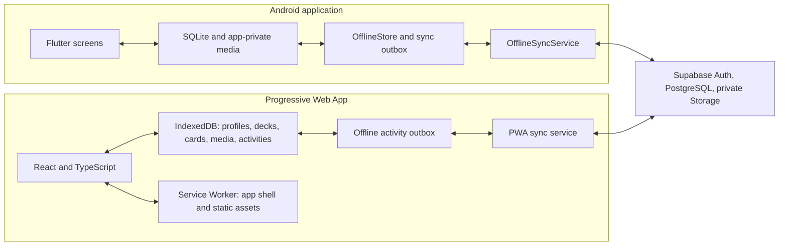
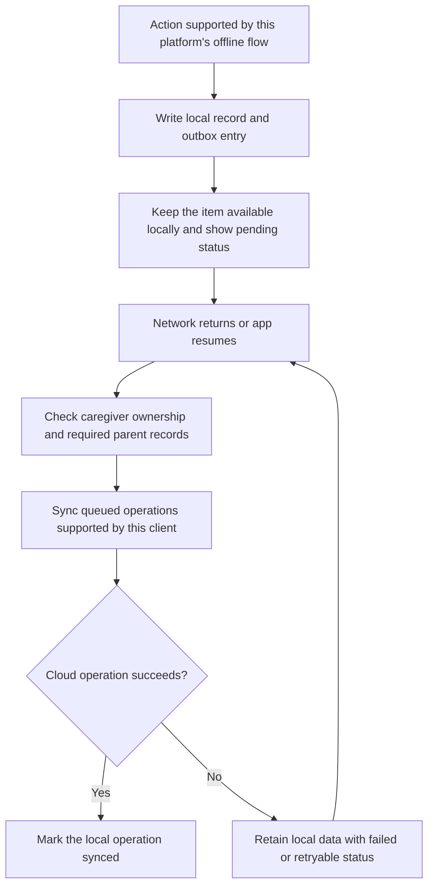

<p align="center">
  
</p>

<h1 align="center">KinCare</h1>
<p align="center"><strong>Care beyond connectivity.</strong></p>
<p align="center">Personalised, caregiver-led activities for older adults, designed for households where internet access may be intermittent.</p>

<p align="center">
  
  
  
  
  
  
</p>

<p align="center">
  <a href="https://github.com/talha7931/kincare-round3">Repository</a> ·
  <a href="#demo-and-project-resources">Demo and resources</a> ·
  <a href="docs/KINCARE_ROUND3_MASTER_SPEC.md">Project specification</a>
</p>

---

## Overview

Caregivers often need activities that feel personal to the person taking part. KinCare lets caregivers organise familiar photographs, questions, and recorded audio into Memory Decks, alongside short recognition and sorting activities. The project pairs Android and browser clients with local storage and a shared Supabase backend to support use when connectivity is unreliable.

KinCare is intended for older adults and the caregivers who support them. It is a prototype for cognitive engagement and caregiver record-keeping; it is not a clinical assessment or treatment service.

### Inspiration

KinCare is shaped by two practical needs: familiar photographs and stories can make an activity more personal, and caregiver-supported activities should remain useful when internet access is unreliable. The prototype brings those ideas into a shared Android and browser experience.

## Core Features

| Area | What is in the codebase | Current status |
| --- | --- | --- |
| **Memory Decks** | Caregivers can manage decks and cards with a photo, question, memory story, and optional recorded question or story audio. The elderly viewer separates recall from revealing the story. | Implemented in both clients; live account and cross-client acceptance still need verification. |
| **Cognitive games** | Odd One Out and Everyday Object Sorting use curated content, accessible tap interactions, spoken prompts, feedback, and activity response records. | Game screens and content are present; end-to-end acceptance remains in progress. |
| **Offline support** | Android uses SQLite, app-private media, and a local outbox. The PWA uses IndexedDB, a local outbox, and a Service Worker cache for the app shell and static assets. | Offline caching and synchronization code is present. Complete reconnect and device acceptance is not yet established. |
| **Caregiver workspace** | Caregiver sign-in and profile management, Memory Deck management, activity history, date-filtered summaries, and report views. | Authentication and cloud workflows depend on project configuration and still need live Supabase verification. |
| **Engagement reports** | Reports summarise recorded sessions and responses. Android can share or save a PDF; the PWA can print or save its report as PDF. | Descriptive reporting is implemented; it is not a clinical outcome measure. |
| **Accessibility and language** | Elderly-facing views use large controls and readable text. Curated game prompts include English, Hindi, and Marathi text and speech paths where translated content and a suitable voice are available. | Speech playback depends on platform voice support; the PWA uses the browser Web Speech API. |

## Application Screenshots

No relevant application screenshots are currently committed. The repository includes the KinCare icon used above, but not product screen captures. Add reviewed screenshots here when they are available.

| Caregiver workspace | Memory Deck experience | Cognitive games |
| :---: | :---: | :---: |
| _Screenshot not yet included_ | _Screenshot not yet included_ | _Screenshot not yet included_ |

## System Architecture

Both clients use the same Supabase project and logical data model. Each client has its own local persistence layer. Supabase migrations in this repository define the database tables, Row Level Security policies, and private media bucket policies.



The database stores caregiver-owned profiles, Memory Decks and cards, media metadata, activity sessions, and responses. Family photos and audio bytes are stored in Supabase Storage. The clients use caregiver-scoped local records; the repository includes RLS policies for access control. Live policy behavior should still be tested against a configured Supabase project.

## Offline Synchronisation

Where offline actions are supported, the client writes local data and a pending outbox entry. Android's sync service checks network, internet, and Supabase reachability and processes caregiver-scoped profile, deck, card, media, and activity operations. The PWA queues activity sessions and responses in IndexedDB; profile or deck edits and media uploads still require connectivity. Its sync service retries when the browser reports that it is online or the app becomes visible.



Previously cached profiles, decks, cards, and media can be read locally. Offline availability depends on content having been cached successfully before connectivity is lost and on the device or browser retaining its local storage. Synchronisation is not a substitute for testing the complete offline-and-reconnect journey on each target device.

## Technology Stack

| Technology | Responsibility |
| --- | --- |
| Flutter and Dart | Native Android user interface, caregiver and elderly journeys, local activity logic, and text-to-speech integration. |
| SQLite (sqflite) | Android profiles, decks, cards, media metadata, activity records, cache state, and synchronization outbox. |
| App-private file storage | Android copies of cached photographs, audio, and other media. |
| React and TypeScript | Browser caregiver workspace, elderly experience, Memory Decks, games, history, and reports. |
| IndexedDB | PWA cache for profiles, decks, cards, media, sessions, responses, and queued activity writes. |
| Service Worker and Cache API | PWA app-shell and static-asset caching. |
| Supabase Auth | Caregiver authentication. |
| Supabase PostgreSQL | Shared application records, accessed through the policies in `supabase/migrations/`. |
| Supabase Storage | Private family-media objects and their metadata. |
| Flutter Test, Vitest, and TypeScript | Automated Flutter and PWA test suites and browser build checks. |

## Project Structure

```text
kincare-round3/
├── android_app/
│   ├── android/                   # Android Gradle project
│   ├── assets/
│   │   └── cognitive_games.json   # Bundled Android game content
│   ├── lib/                       # Flutter screens, local store, sync, reports
│   ├── test/                      # Flutter unit and widget tests
│   ├── dart-defines.example.json  # Safe local-config template
│   └── pubspec.yaml
├── pwa/
│   ├── public/
│   │   ├── kincare-icon.svg
│   │   └── sw.js                  # PWA Service Worker
│   ├── src/
│   │   ├── components/            # React screens and components
│   │   └── lib/                   # Supabase, IndexedDB, sync, and reporting
│   ├── .env.example
│   └── package.json
├── supabase/
│   ├── migrations/                # Schema and Row Level Security
│   └── seed.sql                   # Default activity types
├── docs/                          # Product spec, schema, test plan, reports
├── build_android_apk.bat
└── README.md
```

## Getting Started

### Clone the repository

```powershell
git clone https://github.com/talha7931/kincare-round3.git
cd kincare-round3
```

### Prerequisites

- Git.
- Flutter SDK and Android Studio with the Android SDK and an emulator or Android device.
- JDK 17 for the Android Gradle configuration.
- Node.js and npm to run the PWA.
- A **development** Supabase project. Do not use production credentials for local experiments.

The Android package requires Dart SDK `>=3.3.0 <4.0.0`. Run `flutter doctor` after installing Flutter and Android Studio to check the local toolchain.

### 1. Configure Supabase

Create a development project. Apply the SQL files in `supabase/migrations/` in filename order using the Supabase CLI or SQL Editor. Run `supabase/seed.sql` to add the default activity types.

Configure the Supabase Auth providers you intend to test. The phone OTP path also requires Supabase phone-provider and test-number/SMS configuration; hosted OTP behavior is not verified by this repository.

Use only the project's **publishable** key in client configuration. Never put a Supabase `service_role` key, database password, or access token in Flutter defines, PWA environment variables, or source control. Keep Row Level Security enabled.

### 2. Run the Android application

In PowerShell:

```powershell
cd android_app
Copy-Item .\dart-defines.example.json .\dart-defines.json
# Edit dart-defines.json with your development project URL and publishable key.
flutter doctor
flutter pub get
flutter run --dart-define-from-file=dart-defines.json
```

The example file contains placeholders for `SUPABASE_URL` and `SUPABASE_PUBLISHABLE_KEY`. The real `dart-defines.json` is ignored by Git. To build a universal release APK:

```powershell
flutter build apk --release --target-platform android-arm,android-arm64,android-x64 --dart-define-from-file=dart-defines.json
```

The APK is written to `android_app/build/app/outputs/flutter-apk/app-release.apk`.

### 3. Run the PWA

In a second terminal, from the repository root:

```powershell
cd pwa
Copy-Item .\.env.example .\.env.local
# Edit .env.local with VITE_SUPABASE_URL and VITE_SUPABASE_PUBLISHABLE_KEY.
npm ci
npm run dev
```

Vite prints a local development URL after startup. The PWA requires its own Supabase environment variables; do not copy the Flutter Dart-define file into the web client.

## Testing

Automated tests are included for:

- **Flutter:** SQLite persistence and migrations, Memory Card synchronization and retry, game content and progress, engagement-report calculations, caregiver navigation, and safe authentication-network diagnostics.
- **PWA:** authentication error handling, cognitive-game rules, Memory Story reveal behavior, and engagement-report calculations.

Run the suites from their project directories:

```powershell
cd android_app
flutter test
flutter analyze

cd ..\pwa
npm test
npm run build
npm run lint
```

The test files describe automated coverage; this README does not claim that the commands have passed in every environment. Real Supabase workflows and full physical-device offline journeys still need manual acceptance testing.

## Evaluation: What KinCare Measures

The reports derive descriptive summaries from recorded activity sessions in the selected date range. The Android and PWA reporting helpers currently calculate:

| Metric | Measurement method |
| --- | --- |
| Total sessions | Count of recorded sessions whose start date falls inside the selected UTC date range. |
| Session status | Counts of completed, abandoned, and in-progress sessions. |
| Completion rate | Completed sessions divided by completed plus abandoned sessions; in-progress sessions are not included in this ratio. |
| Participation days | Number of distinct UTC dates with a recorded session. |
| Sessions per day | Total sessions divided by the number of days in the selected reporting period. |
| Activity distribution | Counts grouped by activity type, UTC day, and week. |
| Response summaries | Plain-language summaries of recorded item selections, placements, or Memory Deck responses. |

These are activity and engagement records, not measures of memory, cognitive ability, health, or treatment effectiveness. No clinical validation, participant-study result, or improvement claim is reported.

## Who Benefits, and Who Could Be Harmed?

KinCare is designed for:

- Older adults who prefer simple activities grounded in familiar photographs and everyday objects.
- Caregivers who want to prepare personalised prompts and review a factual activity history.
- Households where connectivity is intermittent but content has already been cached.

Potential harms also need attention:

- A photograph, question, or story may bring up an upsetting memory. Caregivers should choose content with the older adult's preferences in mind and stop an activity if it causes distress.
- Family photographs and recordings are sensitive. Use a development Supabase project for testing, obtain permission before uploading another person's media, and do not place service-role credentials in a client.
- A browser or device may lack a suitable Hindi or Marathi speech voice, or may pronounce a prompt incorrectly. The PWA depends on browser speech synthesis for generated speech; caregiver-recorded Memory Deck audio is a separate playback path.
- Session counts and completion rates can be misread as evidence of cognitive ability. They describe recorded app use only.

## Current Limitations

- KinCare is a prototype. Authentication, hosted phone OTP configuration, RLS isolation, and cross-client data visibility still need testing with a configured Supabase project.
- The game flows are present, but full live-backend and physical-device acceptance is pending.
- Device enrollment and some account setup steps are incomplete. Offline activity use requires suitable profiles, media, and device data to have been prepared in advance.
- Offline support depends on previously cached content and local storage retention. Browser storage can be cleared or evicted; the Service Worker caches the app shell and static assets, not an unlimited copy of all remote content.
- PWA generated speech uses `window.speechSynthesis`; a `hi-IN` locale request does not guarantee that the browser has a Hindi voice installed.
- The PWA uses the browser's `navigator.onLine` state to trigger retries; that signal does not prove Supabase is reachable.
- Language coverage is limited to the translations included in game content. The surrounding application interface is primarily English.
- KinCare has not been clinically validated and does not provide diagnosis, treatment recommendations, or automated speech transcription.

## Future Roadmap

The following items are **planned, not implemented commitments**:

- Additional cognitive activities and more configurable content.
- A Time Credits module for recognising caregiver contribution.
- Caregiver wellbeing resources.
- More language options, voice controls, and accessibility testing.
- Stronger synchronization recovery, conflict review, and retry feedback.
- A clearer device enrollment flow.
- Broader usability testing with older adults and caregivers, including physical-device tests across connectivity conditions.

## Demo and Project Resources

- **GitHub repository:** [talha7931/kincare-round3](https://github.com/talha7931/kincare-round3)
- **Android APK:** (https://drive.google.com/file/d/17DHLpigOYhjbNCdKA7VzqfnXcRbvLCwU/view?usp=sharing)
- **Project video folder:** [Existing Google Drive link](https://drive.google.com/drive/folders/1TMXi_W6k-ONsviEjYIlVi-6cuzL5jjPp) — its current access settings have not been verified.
- **Project specification:** [KinCare Round 3 master spec](docs/KINCARE_ROUND3_MASTER_SPEC.md)
- **Implemented scope and limitations:** [Feature status](docs/IMPLEMENTED_FEATURES_AND_LIMITATIONS.md)
- **Database schema:** [Database schema](docs/DATABASE_SCHEMA.md)
- **Offline sync design:** [Offline synchronization](docs/OFFLINE_SYNC.md)
- **API contracts:** [API contracts](docs/API_CONTRACTS.md)
- **Test plan:** [Test plan](docs/TEST_PLAN.md)
- **Submission checklist:** [Submission checklist](docs/SUBMISSION_CHECKLIST.md)

## Disclaimer

KinCare is a prototype for caregiver-supported engagement and record-keeping. It is not a medical device, diagnostic tool, or treatment. It must not be used to diagnose a condition or make care decisions in place of a qualified healthcare professional.

<p align="center"><strong>Familiar moments. Meaningful connection.</strong></p>
